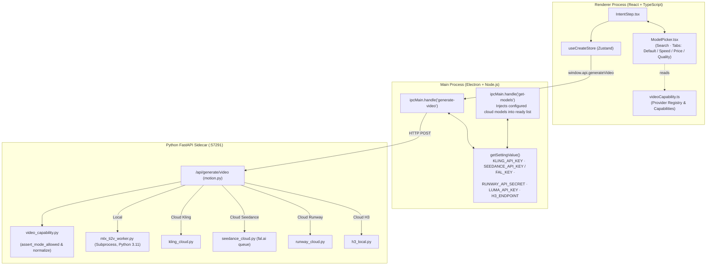

# Video Generation Hub — Architecture & Reference

> **Status:** IMPLEMENTED  
> **Module:** `features/create`, `src/main`, `sidecar/api`

---

## 1. Overview & Vision

The **Video Generation Hub** is a multi-model video synthesis system that combines **free local inference on Apple Silicon (MLX)** with **top-tier cloud API providers** behind a unified, intuitive creative interface.

Inspired by multi-model platforms like Krea.ai, but designed with significant advantages for professional creators:
- **Zero-cost, private local generation:** Free unlimited rendering on your Mac via MLX (Wan 2.2 TI2V-5B).
- **Direct timeline integration:** Rendered clips flow directly into the editor timeline, voiceover pipeline, and project media library.
- **Unified parameter interface:** Consistent prompt conditioning, duration stepper, aspect ratio controls, and reference management regardless of the underlying backend.

---

## 2. Supported Models & Providers

| Model | Runtime | Resolution | Duration | Typ. Speed | Price | Quality | Capabilities |
|---|---|---|---|---|---|---|---|
| **Wan 2.2 TI2V-5B** | ⚡ Local (MLX q8) | 832×480 | 1.7–5.0 s (41–121 frames) | ~4 min | Free | ★★★☆☆ | Image-to-Video, prompt-driven camera motion |
| **Wan 2.1 T2V-1.3B** | ⚡ Local (Diffusers) | 832×480 | 2–3 s | ~3 min | Free | ★★☆☆☆ | Text-to-Video |
| **SVD XT** | ⚡ Local (PyTorch MPS) | 1024×576 | 2–3.5 s (14–25 frames) | ~2 min | Free | ★★☆☆☆ | Image animation (no text prompt) |
| **Seedance 2.5** | ☁️ Cloud (fal.ai) | 1080p | 4–15 s | ~30 s | \$0.04/s | ★★★★★ | Image-to-Video, fast, high cinematic quality |
| **Kling 4.0** | ☁️ Cloud (Kling API) | 1080p | 5–10 s | ~45 s | \$0.05/s | ★★★★★ | Image-to-Video, Start+End framing, realistic motion |
| **Runway Gen-4.5** | ☁️ Cloud (Runway API) | 1080p | 5–10 s | ~60 s | \$0.05/s | ★★★★★ | Image-to-Video, commercial advertising look |
| **MiniMax H3** | ☁️ Cloud (SGLang/API) | 1344×768 | 5–10 s | ~45 s | \$0.04/s | ★★★★☆ | First-frame to video + synchronized audio |
| **Luma Dream Machine** | ☁️ Cloud (Luma API) | 720p | 5 s | ~60 s | \$0.04/s | ★★★★☆ | Image-to-Video, dynamic camera movement |

---

## 3. Architecture & Data Flow

---

## 4. UI Layer Components

1. **`ModelPickerTrigger` & `ModelPicker` (`src/renderer/src/features/create/ui/ModelPicker/`):**
   - Modal dialog with interactive search input.
   - Quick sorting pills: `Default`, `Speed` (fastest first), `Price` (free first), `Quality` (highest rating first).
   - Categorized sections: **⚡ Локальные (бесплатно)** and **☁️ Облачные (API ключ)**.
   - Card badges: `Popular`, `New`, `Free`, `Fast`.
   - Live readiness badges: `✓` for active/ready models, `↓ скачать` for uninstalled local weights, `🔑 нет ключа` for cloud providers lacking API keys.

2. **Duration Stepper (`IntentStep.tsx`):**
   - Clamped within `[minDurationSec, maxDurationSec]` specific to the active provider.
   - For Wan TI2V, values automatically snap to `4n+1` latents (41 frames ≈ 1.7s, 81 frames ≈ 3.4s, 121 frames ≈ 5.0s).

3. **Aspect Ratio Selector (`IntentStep.tsx`):**
   - Options: `16:9` (Wide), `1:1` (Square), `9:16` (Portrait / Shorts).

---

## 5. API Keys Configuration

API keys are stored in the SQLite application settings database and managed via `Settings`:
- `KLING_API_KEY` — Kling AI developer key.
- `SEEDANCE_API_KEY` or `FAL_KEY` — fal.ai access token for Seedance 2.5.
- `RUNWAY_API_SECRET` — Runway Developer API key.
- `LUMA_API_KEY` — Luma Dream Machine API key.
- `H3_ENDPOINT` — Self-hosted or cloud SGLang URL for MiniMax H3.

When any key is provided, the main process automatically reports the corresponding model as `status: ready` via `window.api.getModels()`.

---

## 6. Hardware Compatibility (Apple Silicon M4 Max 64GB)

- **Wan 2.2 TI2V-5B (MLX q8):**
  - Disk weights: ~21 GB (Transformer 5 GB q8 + T5 11 GB + VAE 2.6 GB).
  - Peak inference memory: ~28–29 GB.
  - Generates completely in unified memory without swapping on a 64 GB Mac.
- **Isolated Subprocess Execution:**
  - `mlx_ti2v.py` launches `mlx_ti2v_worker.py` in an isolated Python 3.11 virtual environment.
  - When generation completes or cancels, the worker process exits and memory is immediately returned to macOS.
